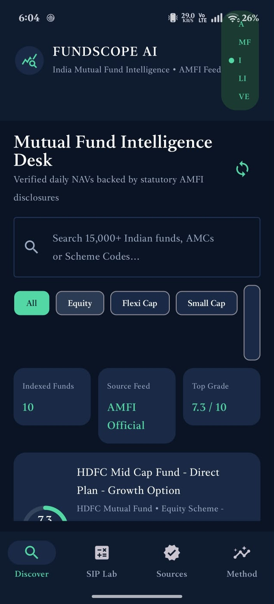
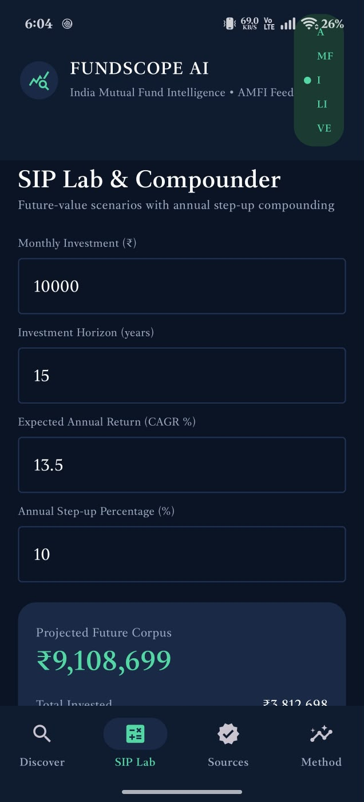
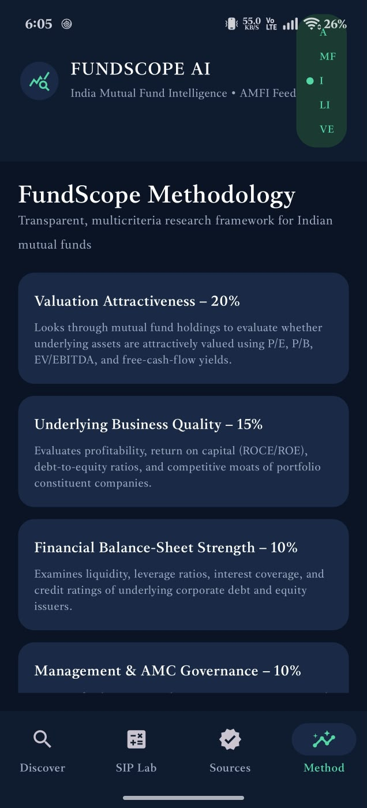
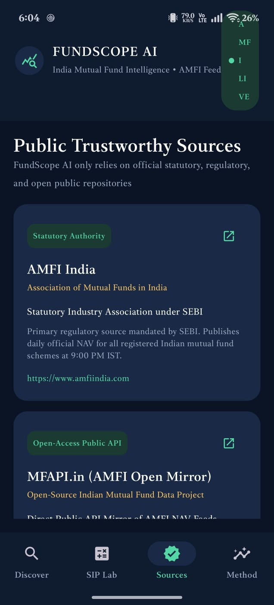

# FundScope AI 📈

[](https://kotlinlang.org)
[](https://developer.android.com/studio/releases/gradle-plugin)
[](https://developer.android.com/jetpack/compose)
[](https://m3.material.io)
[](https://developer.android.com/training/data-storage/room)
[](https://www.amfiindia.com)
[](https://developer.android.com)

**FundScope AI** is a modern, India-first mutual fund intelligence and quantitative research desk built natively for Android using **Jetpack Compose**, **Material 3 Adaptive**, and **Room Database**. 

It delivers real-time Net Asset Values (NAV), multi-factor investment scorecards, compound return projections, and official risk profiles anchored strictly in public statutory regulatory feeds from **AMFI (Association of Mutual Funds in India)** and **SEBI**.

---

## 🌟 Key Features

### 1. 📱 Adaptive & Responsive UI (Phone, Foldable & Tablet)
- **Dynamic Form Factor Adaptation**: Automatically adapts between phone, foldable, tablet, and desktop viewports using Compose constraints.
- **Compact Viewport (Phones)**: Bottom `NavigationBar` with clean single-column cards and smooth transition animations.
- **Medium Viewport (Foldables / Small Tablets)**: Side `NavigationRail` with an adaptive 2-column grid.
- **Expanded Viewport (Tablets / Chromebooks)**: Split **Two-Pane Master-Detail** layout allowing concurrent fund discovery on the left and comprehensive investment scorecards on the right.

### 2. ⚡ Live AMFI NAV & Mutual Fund Mirror
- **Statutory Daily NAVs**: Direct integration with daily official NAV feeds published by the Association of Mutual Funds in India (via the public `api.mfapi.in` mirror).
- **Search 15,000+ Funds**: Search any registered Indian scheme across Equity, Debt, Hybrid, Index, and Sectoral categories by scheme name, fund house (AMC), or AMFI Scheme Code.
- **Real-Time Synchronisation**: One-tap live NAV sync in the top bar with real-time indicators and date timestamps.
- **Official Daily NAV Hero Card**: Deep-dive into verified historical records with dynamic 3-Year and 5-Year CAGR calculation directly computed from daily NAV data points.

### 3. 🎯 Multi-Factor Investment Scorecard
- Evaluates funds against a balanced quantitative framework:
  - **Valuation Attractiveness (20%)**: Looks through underlying holdings using P/E, P/B, EV/EBITDA, and FCF yields against category medians.
  - **Business Quality (15%)**: Evaluates ROCE/ROE, competitive moats, and operational margins.
  - **Balance-Sheet Strength (10%)**: Analyzes debt-to-equity, liquidity, and issuer credit health.
  - **Management & Governance (10%)**: Measures manager tenure stability and AMC stewardship ethics.
  - **Portfolio Diversification (10%)**: Quantifies top-10 concentration and active share.
  - **Mandate Consistency (10%)**: Verifies style discipline over time.
  - **Risk Management & Volatility (10%)**: Evaluates standard deviation, beta, and downside capture.
  - **Performance Consistency (10%)**: Assesses rolling returns across multiple market cycles.
  - **Cost Efficiency (5%)**: Considers Total Expense Ratio (TER) and portfolio turnover.

### 4. 🛡️ SEBI Standard Riskometer
- Standardized 6-tier risk classification:
  `Low` • `Low–Moderate` • `Moderate` • `Moderately High` • `High` • `Very High`
- In accordance with SEBI riskometer disclosure guidelines for mutual funds.

### 5. 🧮 SIP Lab & Wealth Compounder
- Future-value compounding model with dynamic annual step-up increment support.
- Calculates total invested capital, estimated gains, and projected terminal corpus.

### 6. 🏛️ Public Trustworthy Data Sources
- Built-in directory with one-tap deep links to statutory authorities:
  - **AMFI India**: Statutory industry association publishing daily net asset values.
  - **MFAPI.in**: High-availability open public API mirror of AMFI daily feeds.
  - **SEBI Regulations**: Categorization, rationalization, and Riskometer frameworks under SEBI (Mutual Funds) Regulations, 1996.
  - **RBI & CCIL**: Risk-free sovereign benchmark rates (91-day T-Bill, 10-year G-Sec).

### 7. 🚀 High-Performance Splash Screen
- Dedicated startup screen initializing the Room database, caching baseline funds, warming up live NAV feeds, and ensuring instant offline readiness.
- Includes a *"Continue to Workspace"* fallback for uninterrupted offline access.

### 8. ↩️ Double Back Press Exit Prevention
- Intelligent back navigation guards:
  - Pressing back from any Fund Detail cleanly dismisses the detail pane without exiting.
  - Pressing back from any main tab displays a toast (`"Press back again to exit"`), preventing accidental closures.

---

## 🎨 App Icon & Visual Identity
- **Vector Adaptive Icon**: Precision financial reticle with deep navy background, concentric radar lines, rising wealth progress bars, and a gold growth spark.
- **Dark Theme Palette**:
  - **Canvas Background**: `#0B1426`
  - **Deep Navy**: `#101B32`
  - **Surface Panel**: `#1A2945`
  - **Mint Accent**: `#55D6A5`
  - **Gold Highlight**: `#FFC766`
  - **Muted Label**: `#9BAAC2`

---

## 🛠️ Architecture & Tech Stack

```
FundScopeAI/
├── app/
│   ├── src/main/
│   │   ├── java/com/fundscope/ai/
│   │   │   ├── MainActivity.kt        # Compose UI, Navigation, Responsive Layouts, Splash
│   │   │   └── data/
│   │   │       ├── FundDatabase.kt    # Room Database, DAOs, and Entities
│   │   │       └── FundRepository.kt  # AMFI API Client, CAGR Engine & Data Synchronization
│   │   ├── res/
│   │   │   ├── drawable/              # Vector Launcher Background & Foreground reticle
│   │   │   ├── mipmap-anydpi-v26/     # Adaptive launcher icons
│   │   │   └── values/                # Colors & themes
│   │   └── AndroidManifest.xml        # Permissions & Activities
```

- **Kotlin 2.0.21** + **KSP**
- **Jetpack Compose** + **Material 3** (`androidx.compose.material3:material3`)
- **Room Database 2.6.1** for offline persistence and Kotlin Coroutines `Flow`
- **Kotlin Coroutines** (`Dispatchers.IO`, `Dispatchers.Main`)
- **Zero Heavy 3rd-Party Dependencies**: Pure native Android SDK without bloated networking libraries.

---

## 🚀 Getting Started

### Prerequisites
- **Android Studio Ladybug (2024.2+)** or newer.
- **JDK 17** (or Android Studio bundled JBR 17/21/25).
- **Android Device / Emulator** running Android 10+ (API level 29+).

### Building from Source

1. **Clone the repository:**
   ```bash
   git clone https://github.com/srbhgalinde/FundScopeAI.git
   cd FundScopeAI
   ```

2. **Open in Android Studio:**
   - Open the cloned directory.
   - Wait for Gradle sync to complete.

3. **Build Debug APK via CLI:**
   ```bash
   ./gradlew assembleDebug
   ```
   The output APK will be generated at:
   `app/build/outputs/apk/debug/app-debug.apk`

4. **Install & Run on Device:**
   ```bash
   adb install -r -t app/build/outputs/apk/debug/app-debug.apk
   adb shell am start -n com.fundscope.ai/.MainActivity
   ```

5. **Screenshots:**

   
   
   
   

  
---

## ⚖️ Disclaimer & Compliance Notice
FundScope AI is an independent financial technology research tool. It derives data from public AMFI and SEBI feeds. Mutual fund investments are subject to market risks; please read all scheme-related documents carefully before investing. Historical NAV performances and CAGR scores are for informational research purposes and do not represent guaranteed future returns or investment advisory advice.

---

## 📄 License
This project is licensed under the Apache 2.0 License - see the [LICENSE](LICENSE) file for details.
